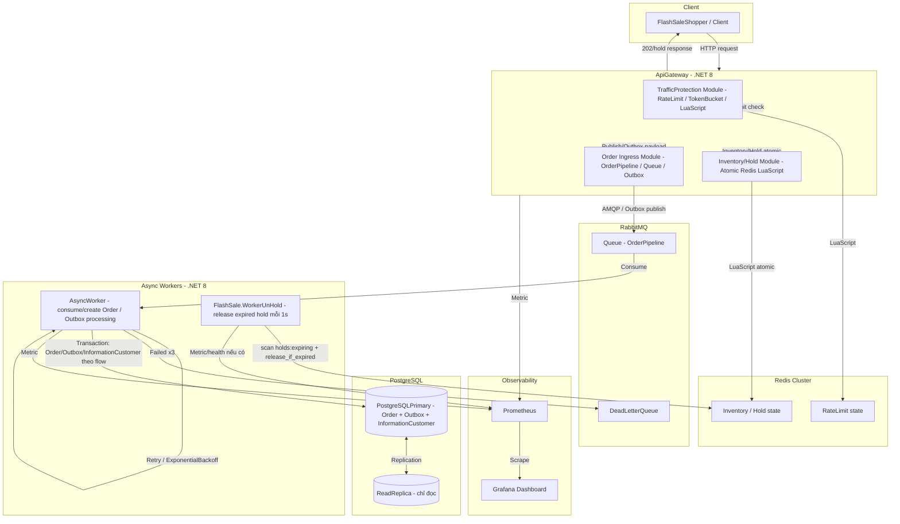

# Kiến trúc hệ thống — Distributed Flash-Sale Engine & Event-Driven Order Pipeline

## 1. Kiến trúc tổng quan

Hệ thống chia thành hai luồng xử lý rõ rệt: **fast-path** (nhận yêu cầu/giữ chỗ/nhận đơn, mục tiêu p99 thấp) và **async-path** (xử lý đơn hàng bất đồng bộ qua `Queue`/`Outbox`/consumer). Mỗi thành phần trong diagram sau sử dụng đúng tên đã chốt trong `docs/domain-glossary.md`.

> **Cập nhật Phase 8 (đã chốt 8.1/8.2, chưa implement):** bổ sung luồng **Hold/Reservation** (giữ chỗ TTL 60s, reserve trên Redis, submit tạo Outbox payload, Outbox pattern lưu `InformationCustomer` và publish message, consumer RabbitMQ tạo `Order`) và worker nhả slot **`FlashSale.WorkerUnHold`**. Endpoint `POST /api/v1/flash-sale/buy` hiện tại chạy song song. Chi tiết chuẩn: `docs/plan-hold-reservation-flow.md`.

**Luồng fast-path hiện tại - `POST /api/v1/flash-sale/buy` (giữ song song):**

1. `FlashSaleShopper` gửi request mua hàng đến `ApiGateway`.
2. `ApiGateway` kiểm tra `RateLimit` (Redis Lua Script/Token Bucket). Vượt ngưỡng → HTTP 429.
3. Kiểm tra và trừ `Inventory` atomic trên Redis. Hết hàng → 400 `INSUFFICIENT_INVENTORY`, không tạo `Order`.
4. Trừ kho thành công → publish `Message` vào `Queue` (`OrderPipeline`) và trả `Http202Accepted`.

**Luồng Hold/Reservation (Phase 8, đã chốt 8.1/8.2, chưa implement):**

1. `POST /api/v1/flash-sale/hold` (`productId`,`quantity`): kiểm tra `RateLimit` + ràng buộc 1 user/1 hold active; kiểm tra đủ quantity trong Redis.
   - Không đủ → 400 `INSUFFICIENT_INVENTORY` (hết hàng), không tạo hold.
   - Đủ → reserve/giảm available ngay, tạo `hold:{holdId}` TTL 60s, ghi `hold:user:{clientId}`, thêm `holds:expiring` (ZSET theo `expiresAt`) → trả `holdId`, `expiresAt`, `ttlSeconds`.
2. `POST /api/v1/flash-sale/hold/{holdId}/confirm` (Name, PhoneNumber, Address bắt buộc): kiểm tra hold còn hạn/thuộc user/chưa consumed tại thời điểm submit.
   - Hết hạn/không hợp lệ/đã dùng → 409/410 (theo contract).
   - Hợp lệ → consume hold, tạo payload Outbox (Transactional Outbox Pattern). Outbox pattern chạy: lưu `InformationCustomer` và publish message lên RabbitMQ. Consumer nhận message và tạo `Order` (idempotent).
3. `POST /api/v1/flash-sale/hold/{holdId}/release`: hủy giữ chỗ, trả slot/quantity về Redis (idempotent).
4. Không submit trong 1 phút hoặc reload trang (mất phiên UI): `FlashSale.WorkerUnHold` quét mỗi 1s và `release_if_expired` để trả quantity/nhường chỗ (SLA ~1–2s sau hết hạn).

**Luồng async-path/Outbox hiện tại (FR-04, FR-05):**

- `AsyncWorker` tiêu thụ `Message` từ `Queue`.
- Với luồng `/buy` hiện tại: ghi `Order` + `Outbox` trong cùng transaction (`Transactional Outbox Pattern`), xử lý retry/DLQ khi lỗi.
- Với luồng Hold (theo flow chuẩn 8.2): Outbox payload được tạo khi confirm; Outbox processor lưu `InformationCustomer` + publish message; consumer tạo `Order`. (Chi tiết transaction/điểm lưu nhất quán cụ thể hóa khi implement.)

Nếu xử lý thất bại → `Retry` với `ExponentialBackoff`; sau 3 lần vẫn lỗi → chuyển `Message` vào `DeadLetterQueue`.

**Monitoring (FR-06):**

`ApiGateway` và `AsyncWorker` xuất `Metric` (`P99Latency`, `ErrorRate`, `QueueDepth`, `DlqSize`, `InventoryRemaining`) để `Prometheus` scrape; `DevOps` xem qua `Grafana Dashboard`. Endpoint `HealthCheck` cho việc kiểm tra trạng thái dịch vụ.

## 2. Tech Stack

Mỗi lựa chọn đi kèm lý do gắn với NFR cụ thể trong `docs/prd.md`:

| Thành phần | Lựa chọn | Lý do gắn với NFR |
|------------|----------|-------------------|
| Backend Framework | .NET 8 (ASP.NET Core), Clean Architecture + CQRS | Ràng buộc kỹ thuật bắt buộc trong PRD; hỗ trợ async pipeline cho `FastPath` dưới 20ms (NFR-01). |
| Caching & Rate Limiting | Redis Cluster + Lua Scripting | Ràng buộc bắt buộc; lưu trạng thái `RateLimit` và `Inventory` chia sẻ cho nhiều instance `ApiGateway`, không bị bypass khi scale out (NFR-04, NFR-05). |
| Message Broker | RabbitMQ + MassTransit | Ràng buộc bắt buộc; cung cấp `Queue` bền vững cho `OrderPipeline`, hỗ trợ `DeadLetterQueue` và `Retry` (FR-03, FR-05, NFR-06). |
| Database | PostgreSQL Primary + Read Replica | Ràng buộc bắt buộc; `PostgreSQLPrimary` đảm bảo ACID transaction cho `Order` + `Outbox` (NFR-06); `ReadReplica` tách tải đọc (NFR-05). |
| Container & Orchestration | Docker + Docker Compose | Ràng buộc bắt buộc; đóng gói tất cả dịch vụ (`ApiGateway`, `AsyncWorker`, Redis, RabbitMQ, PostgreSQL, k6, Prometheus, Grafana) và khởi tạo toàn bộ bằng `DockerCompose` (NFR-08). |
| Load Testing | k6 | Ràng buộc bắt buộc; giả lập 8.000 `VirtualUser` đồng thời (NFR-03, FR-07). |
| Monitoring | Prometheus + Grafana | Ràng buộc bắt buộc; thu thập và hiển thị `Metric` cho `DevOps` (NFR-07, FR-06). |

Không có frontend/UI trong MVP (ngoài phạm vi theo PRD).

## 3. Module / Component breakdown

Mỗi module map với FR và thuật ngữ trong `docs/domain-glossary.md`:

| Module | Thuật ngữ chuẩn (code) | FR liên quan | Mô tả ngắn |
|--------|----------------------|--------------|------------|
| TrafficProtection Module | `ApiGateway` → `RateLimit` / `TokenBucket` / `LuaScript` | FR-01 | Kiểm tra `RateLimit` trước khi xử lý tiếp; trả 429 nếu vượt ngưỡng. |
| Inventory/Hold Module | `ApiGateway` → `Inventory` / `Hold` / `AtomicInventoryOffloading` / `LuaScript` | FR-02 | Kiểm tra/trừ hoặc reserve `Inventory` atomic trên Redis; chặn `OverSelling`; tạo/consume/release hold TTL 60s (Phase 8). |
| Order Ingress/Outbox Module | `ApiGateway` → `OrderPipeline` / `Queue` / `Outbox` / `Http202Accepted` | FR-03, FR-04 | `/buy`: publish message và trả `Http202Accepted`. Hold confirm (Phase 8): tạo payload Outbox, Outbox pattern lưu `InformationCustomer` + publish message. |
| Order Processing Module | `AsyncWorker` / consumer → `Order` / `Outbox` / `Retry` / `ExponentialBackoff` | FR-04, FR-05 | Tiêu thụ `Queue`, xử lý idempotent, tạo `Order` theo luồng tương ứng, `Retry`/`DeadLetterQueue` khi lỗi. |
| Hold Expiry Module | `WorkerUnHold` → `Hold` / `Inventory` / `LuaScript` | FR-02, NFR-06 | Quét `holds:expiring` mỗi 1s, `release_if_expired` idempotent để trả slot. (Phase 8) |
| Observability Module | `Prometheus` / `Grafana` / `Metric` / `HealthCheck` | FR-06 | Xuất `Metric` (bao gồm `InventoryRemaining` = available sau reserve), `HealthCheck`, dashboard. |

Tất cả module chạy trong container `Docker`, khởi tạo qua `DockerCompose`.

## 4. Bảo mật

- **Authentication / Authorization:** Sử dụng **ASP.NET Core Identity + Bearer Token (JWT)** (đã chốt trong PRD). Client đăng nhập để nhận token, gửi `Authorization: Bearer <token>`; `ApiGateway` xác thực token trước khi kiểm tra `RateLimit`/xử lý hold/buy (FR-01, NFR-04). Phase 8: hold/confirm/release phải gắn với `clientId` từ JWT, kiểm tra quyền sở hữu hold.
- **Transport:** Tất cả endpoint chỉ cho phép gọi qua HTTPS (NFR-04).
- **Secret:** Chuỗi kết nối Redis, RabbitMQ, PostgreSQL và cấu hình JWT lưu trong environment variable / Docker secret, không hardcode trong code.
- **Threat mặc định phải chống:**
  - Injection: dùng parameterized query / ORM (Entity Framework Core) khi ghi `Order`, `Outbox`, `InformationCustomer` vào `PostgreSQLPrimary`.
  - IDOR: kiểm tra `holdId` thuộc `clientId` hiện tại trước confirm/release/get; không cho thao tác hold của user khác.
  - Rate limit bypass: `RateLimit` lưu trạng thái trên `Redis Cluster` (không local memory), áp dụng phân tán trên nhiều instance `ApiGateway` (NFR-04).
  - Không cho phép client gửi vô hạn request mà không bị chặn (NFR-04).

## 5. Performance

Target lấy trực tiếp từ NFR:

| Mục tiêu | Giá trị | Nguồn NFR | Chiến lược đạt được |
|----------|---------|-----------|---------------------|
| p99 latency `FastPath` | < 20ms (mục tiêu ~18ms cho inventory offloading) | NFR-01 | Trừ `Inventory` atomic trên Redis qua `LuaScript` (`AtomicInventoryOffloading`), không đọp DB trên fast-path. |
| Spike traffic | 15.000 RPS | NFR-02 | `RateLimit` phân tán qua Redis chặn traffic ngoài ngưỡng trước khi xuống hạ tầng. |
| Concurrent users | 8.000 `VirtualUser`, Error Rate < 1% | NFR-03 | `OrderPipeline` bất đồng qua RabbitMQ, `ApiGateway` trả 202 ngay, không block chờ worker. |
| Khả năng mở rộng | Scale horizontally | NFR-05 | Trạng thái `RateLimit` và `Inventory` chia sẻ qua Redis Cluster; `ApiGateway` và `AsyncWorker` có thể chạy nhiều instance. |

## 6. Data model tổng quan

Tên entity trùng khớp thuật ngữ trong `docs/domain-glossary.md` (bổ sung Phase 8):

| Entity/Table | Nơi lưu | Quan hệ | Mô tả |
|--------------|---------|---------|-------|
| `Product` | PostgreSQLPrimary (và catalog bên ngoài trong tương lai) | 1:N với `Inventory` | Sản phẩm được bán trong `FlashSale`. |
| `Inventory` | Redis Cluster (`inventory:{productId}`) | Thuộc 1 `Product` | Số lượng tồn kho khả dụng; trừ/reserve atomic qua `LuaScript` (Hold: available sau reserve). |
| `Hold` (state) | Redis Cluster (`hold:{holdId}`, `hold:user:{clientId}`, `holds:expiring`) | Thuộc `ClientId`/`Product` | Trạng thái giữ chỗ TTL 60s (Phase 8), reserve slot và được nhả khi hết hạn/hủy/confirm. |
| `Order` | PostgreSQLPrimary | N:1 với `Product` | Đơn hàng được tạo qua luồng async (consumer). |
| `Outbox` | PostgreSQLPrimary | Gắn với luồng xử lý đơn/sự kiện | Bảng sự kiện Transactional Outbox Pattern. |
| `InformationCustomer` | PostgreSQLPrimary | Gắn với `HoldId` (và/hoặc `Order` tùy thiết kế chi tiết) | Thông tin khách hàng submit confirm (Phase 8). |

**Đề xuất thiết kế DB `InformationCustomer` (Story 8.2, cụ thể hóa khi implement):**
- Cột: `Id` (UUID, PK), `Name` (varchar, NOT NULL), `Address` (varchar, NOT NULL), `PhoneNumber` (varchar, NOT NULL), `HoldId` (UUID/varchar, NOT NULL, unique/index để chống trùng theo hold).
- Liên kết: nên bổ sung `OrderId` (nullable/hoặc gán sau) hoặc `CorrelationId` nếu cần truy vết với `Order`; FK/constraint cụ thể chốt trong migration 8.x.
- Validation: `Name/Address/PhoneNumber` bắt buộc, trim, không rỗng; giới hạn độ dài đề xuất `Name` ≤ 200, `Address` ≤ 500, `PhoneNumber` ≤ 20 (định dạng số/`+`/space/`-`).

**Redis keys/index (Phase 8):** `inventory:{productId}`, `hold:{holdId}`, `hold:user:{clientId}`, `holds:expiring` (ZSET, score = expiresAt epoch). **Lua scripts:** `hold_create.lua`, `hold_confirm.lua`, `hold_release.lua`/`hold_release_if_expired.lua`.

Các tên kỹ thuật thuần túy (không phải thuật ngữ nghiệp vụ, không cần nằm trong glossary):
- `Outbox` — đã có trong glossary dưới domain Database, dùng làm tên bảng và tên khái niệm nghiệp vụ đồng thời.
- CQRS pattern, Repository pattern, Unit of Work — tên kỹ thuật nội bộ, dùng trong code, không phải thuật ngữ nghiệp vụ hiển thị cho người dùng.

## 7. Rủi ro kỹ thuật đã biết

| Rủi ro / Trade-off | Mô tả | Liên quan FR/NFR | Điều khiển |
|--------------------|-------|------------------|------------|
| Eventual consistency Redis ↔ PostgreSQL | Inventory/Hold thay đổi trên Redis trước; `Order`/sự kiện hoàn tất sau qua async flow. Có thể lệch trạng thái tạm thời nếu crash giữa chừng. | FR-04, NFR-06 | `Outbox` + idempotency + reconciliation; release hold idempotent. |
| Slot hold bị kẹt | Redis TTL không tự trả `Inventory` khi `hold:{id}` hết hạn. | FR-02, NFR-06 | `holds:expiring` + `FlashSale.WorkerUnHold` quét 1s + Lua `release_if_expired` idempotent. |
| Độ phức tạp luồng Outbox/consumer (Phase 8) | Submit confirm tạo Outbox payload; Outbox lưu `InformationCustomer` + publish; consumer tạo `Order` (khác `/buy` hiện tại), rủi ro sai transaction/thứ tự/duplicate. | FR-03, FR-04, NFR-06 | Contract/payload/idempotency/correlation chốt rõ; test integration/e2e; consumer idempotent. |
| Race condition hold/confirm/release/expiry | Double confirm, confirm sau hết hạn, release đồng thời expiry. | FR-02, FR-03, NFR-06 | Redis Lua atomic, kiểm tra trạng thái/owner/expiry tại server, idempotent handlers. |
| Outbox table tăng dần | Bản ghi `Outbox` lớn dần ảnh hưởng hiệu năng ghi. | NFR-06 | Purge/archive theo cấu hình; theo dõi kích thước bảng. |
| DLQ message retention | Thời gian giữ message trong `DeadLetterQueue` chưa chốt đầy đủ. | FR-05, NFR-07 | `[CẦN LÀM RÕ]` retention/operational policy (Câu 6 PRD). |
| Read Replica lag | `ReadReplica` trễ so với `PostgreSQLPrimary`. | NFR-06 | `[CẦN LÀM RÕ]` acceptable lag (Câu 4 PRD); không dùng replica cho đọc cần nhất quán tức thời. |
| Semantics metrics thay đổi | `InventoryRemaining` chuyển sang available sau reserve, có thể gây hiểu nhầm dashboard cũ. | FR-06, NFR-07 | Cập nhật mô tả dashboard/metrics và theo dõi khi implement 8.8. |

Tất cả FR (FR-01 → FR-07) và NFR (NFR-01 → NFR-08) trong `docs/prd.md` đều được phản ánh trong kiến trúc (bao gồm Phase 8 đã chốt 8.1/8.2). Các điểm `[CẦN LÀM RÕ]` còn lại (ngưỡng rate limit per client, replication lag, purge Outbox chi tiết/retention DLQ) được giữ để chốt sau.
