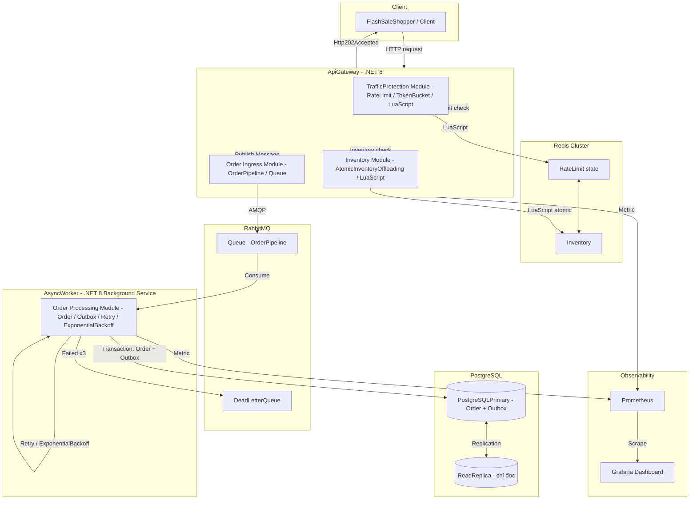

# Kiến trúc hệ thống — Distributed Flash-Sale Engine & Event-Driven Order Pipeline

## 1. Kiến trúc tổng quan

Hệ thống chia thành hai luồng xử lý rõ rệt: **fast-path** (nhận đơn, dưới 20ms p99) và **async-path** (xử lý đơn hàng sau sau khi đã trả 202 Accepted cho client). Mỗi thành phần trong diagram sau sử dụng đúng tên đã chốt trong `docs/domain-glossary.md`.

**Luồng dữ liệu fast-path (FR-01, FR-02, FR-03):**

1. `FlashSaleShopper` (`Client`) gửi HTTP request mua hàng đến `ApiGateway`.
2. `ApiGateway` gọi `TrafficProtection Module` → kiểm tra `RateLimit` qua `LuaScript` (`TokenBucket`) trên `Redis Cluster`. Nếu vượt ngưỡng → trả HTTP 429 ngay, không gọi hạ tầng khác.
3. Nếu rate limit cho phép, `ApiGateway` gọi `Inventory Module` → trừ `Inventory` atomic qua `LuaScript` (`AtomicInventoryOffloading`) trên Redis. Nếu kho hết → trả lỗi hết hàng ngay, không tạo `Order`.
4. Nếu trừ kho thành công → `ApiGateway` đẩy `Message` vào `Queue` (`OrderPipeline`) trên `RabbitMQ` và trả `Http202Accepted` ngay cho `Client` (không chờ xử lý hoàn tất).

**Luồng dữ liệu async-path (FR-04, FR-05):**

5. `AsyncWorker` tiêu thụ `Message` từ `Queue`.
6. `AsyncWorker` ghi `Order` vào `PostgreSQLPrimary` và ghi sự kiện vào bảng `Outbox` trong cùng một transaction database (`Transactional Outbox Pattern`).
7. Nếu xử lý thất bại → `Retry` với `ExponentialBackoff`; sau 3 lần vẫn lỗi → chuyển `Message` vào `DeadLetterQueue`.

**Monitoring (FR-06):**

`ApiGateway` và `AsyncWorker` xuất `Metric` (`P99Latency`, `ErrorRate`, `QueueDepth`, `DlqSize`, `InventoryRemaining`) để `Prometheus` scrape; `DevOps` xem qua `Grafana Dashboard`. Endpoint `HealthCheck` cho việc kiểm tra trạng thái dịch vụ.

## 2. Tech Stack

Mỗi lựa chọn đi kèm lý do gắn với NFR cụ thể trong `docs/prd.md`:

| Thành phần | Lựa chọn | Lý do gắn với NFR |
|------------|----------|-------------------|
| Backend Framework | .NET 8 (ASP.NET Core), Clean Architecture + CQSR | Ràng buộc kỹ thuật bắt buộc trong PRD; hỗ trợ async pipeline cho `FastPath` dưới 20ms (NFR-01). |
| Caching & Rate Limiting | Redis Cluster + Lua Scripting | Ràng buộc bắt buộc; lưu trạng thái `RateLimit` và `Inventory` chia sẻ cho nhiều instance `ApiGateway`, không bị bypass khi scale out (NFR-04, NFR-05). |
| Message Broker | RabbitMQ + MassTransit | Ràng buộc bắt buộc; cung cấp `Queue` bền vững cho `OrderPipeline`, hỗ trợ `DeadLetterQueue` và `Retry` (FR-03, FR-05, NFR-06). |
| Database | PostgreSQL Primary + Read Replica | Ràng buộc bắt buộc; `PostgreSQLPrimary` đảm bảo ACID transaction cho `Order` + `Outbox` (NFR-06); `ReadReplica` tách tải đọc (NFR-05). |
| Container & Orchestration | Docker + Docker Compose | Ràng buộc bắt buộc; đóng gói tất cả dịch vụ (`ApiGateway`, `AsyncWorker`, Redis, RabbitMQ, PostgreSQL, k6, Prometheus, Grafana) và khởi tạo toàn bộ bằng `DockerCompose` (NFR-08). |
| Load Testing | k6 | Ràng buộc bắt buộc; giả lập 8.000 `VirtualUser` đồng thời (NFR-03, FR-07). |
| Monitoring | Prometheus + Grafana | Ràng buộc bắt buộc; thu thập và hiển thị `Metric` cho `DevOps` (NFR-07, FR-06). |

Không có frontend/UI trong MVP (ngoài phạm vi theo PRD).

## 3. Module / Component breakdown

Mỗi module map với FR và thuật ngữ trong `docs/domain-glossary.md`:

| Module | Thuật ngữ chuẩn (code) | FR liên quan | Mô tả ngắn |
|--------|----------------------|--------------|------------|
| TrafficProtection Module | `ApiGateway` → `RateLimit` / `TokenBucket` / `LuaScript` | FR-01 | Kiểm tra `RateLimit` trước khi xử lý tiếp; trả 429 nếu vượt ngưỡng. |
| Inventory Module | `ApiGateway` → `Inventory` / `AtomicInventoryOffloading` / `LuaScript` | FR-02 | Trừ `Inventory` atomic trên Redis; chặn `OverSelling`. |
| Order Ingress Module | `ApiGateway` → `OrderPipeline` / `Queue` / `Http202Accepted` | FR-03 | Đẩy `Message` vào `Queue` trên `RabbitMQ`, trả `Http202Accepted` ngay. |
| Order Processing Module | `AsyncWorker` → `Order` / `Outbox` / `Retry` / `ExponentialBackoff` | FR-04, FR-05 | Tiêu thụ `Queue`, ghi `Order` + `Outbox` trong 1 transaction, `Retry` sau lỗi, chuyển vào `DeadLetterQueue` sau 3 lần. |
| Observability Module | `Prometheus` / `Grafana` / `Metric` / `HealthCheck` | FR-06 | Xuất `Metric`, cung cấp `HealthCheck`, hiển thị trên `Grafana Dashboard`. |

Tất cả module chạy trong container `Docker`, khởi tạo qua `DockerCompose`.

## 4. Bảo mật

- **Authentication / Authorization:** Input PRD chưa chốt cơ chế xác thực (`[CẦN LÀM RÕ]` trong `docs/prd.md` Câu 3). Trong MVP, kiến trúc giả định gọi API không yêu cầu auth phức tạp; nếu sau này chọn API key hoặc JWT, ghi quyết định vào `docs/decisions.md` và cập nhật `docs/domain-glossary.md` nếu cần thuật ngữ mới.
- **Transport:** Tất cả endpoint chỉ cho phép gọi qua HTTPS (NFR-04).
- **Secret:** Chuỗi kết nối Redis, RabbitMQ, PostgreSQL lưu trong environment variable / Docker secret, không hardcode trong code.
- **Threat mặc định phải chống:**
  - Injection: dùng parameterized query / ORM (Entity Framework Core) khi ghi `Order` và `Outbox` vào `PostgreSQLPrimary`.
  - IDOR: `ApiGateway` kiểm tra quyền truy cập trước khi thực hiện `AtomicInventoryOffloading` và publish `OrderPipeline` (chi tiết policy được bổ sung sau khi chốt cơ chế auth).
  - Rate limit bypass: `RateLimit` lưu trạng thái trên `Redis Cluster` (không local memory), áp dụng phân tán trên nhiều instance `ApiGateway` (NFR-04).
  - Không cho phép client gửi vô hạn request mà không bị chặn (NFR-04).

## 5. Performance

Target lấy trực tiếp từ NFR:

| Mục tiêu | Giá trị | Nguồn NFR | Chiến lược đạt được |
|----------|---------|-----------|---------------------|
| p99 latency `FastPath` | < 20ms (mục tiêu ~18ms cho inventory offloading) | NFR-01 | Trừ `Inventory` atomic trên Redis qua `LuaScript` (`AtomicInventoryOffloading`), không đọp DB trên fast-path. |
| Spike traffic | 15.000 RPS | NFR-02 | `RateLimit` phân tán qua Redis chặn traffic ngoài ngưỡng trước khi xuống hạ tầng. |
| Concurrent users | 8.000 `VirtualUser`, Error Rate < 1% | NFR-03 | `OrderPipeline` bất đồng qua RabbitMQ, `ApiGateway` trả 202 ngay, không block chờ worker. |
| Khả năng mở rộng | Scale horizontally | NFR-05 | Trạng thái `RateLimit` và `Inventory` chia sẻ qua Redis Cluster; `ApiGateway` và `AsyncWorker` có thể chạy nhiều instance. |

## 6. Data model tổng quan

Tên entity trùng khớp thuật ngữ trong `docs/domain-glossary.md`:

| Entity | Nơi lưu | Quan hệ | Mô tả |
|--------|---------|---------|-------|
| `Product` | PostgreSQLPrimary (và catalog bên ngoài trong tương lai) | 1:N với `Inventory` | Sản phẩm được bán trong `FlashSale`. |
| `Inventory` | Redis Cluster | Thuộc 1 `Product` | Số lượng tồn kho, được trừ atomic qua `LuaScript`. |
| `Order` | PostgreSQLPrimary | N:1 với `Product` | Đơn hàng tạo sau khi trừ kho thành công, ghi qua `AsyncWorker`. |
| `Outbox` | PostgreSQLPrimary | 1:N với `Order` | Bảng lưu sự kiện liên quan đến `Order` trong Transactional Outbox Pattern. |

Các tên kỹ thuật thuần túy (không phải thuật ngữ nghiệp vụ, không cần nằm trong glossary):
- `Outbox` — đã có trong glossary dưới domain Database, dùng làm tên bảng và tên khái niệm nghiệp vụ đồng thời.
- CQRS pattern, Repository pattern, Unit of Work — tên kỹ thuật nội bộ, dùng trong code, không phải thuật ngữ nghiệp vụ hiển thị cho người dùng.

## 7. Rủi ro kỹ thuật đã biết

| Rủi ro / Trade-off | Mô tả | Liên quan FR/NFR | Điều khiển |
|--------------------|-------|------------------|------------|
| Eventual consistency giữa Redis Inventory và PostgreSQL Order | `Inventory` bị trừ trên Redis ngay, nhưng `Order` chỉ ghi vào `PostgreSQLPrimary` sau khi `AsyncWorker` xử lý. Nếu worker sập giữa thời gian đó, hàng đã bị trừ nhưng chưa có đơn. | FR-04, NFR-06 | Dùng `Outbox` + `Reconciliation` để đối chiếu và khôi phục; cần định nghĩa thời gian purge `Outbox` (`[CẦN LÀM RÕ]` Câu 5). |
| Outbox table tăng dần | Bản ghi `Outbox` không được purge kịp có thể làm bảng phet to ảnh hiệu năng ghi. | NFR-06 | Cần định nghĩa chính sách archive/purge (`[CẦN LÀM RÕ]` Câu 5). |
| DLQ message retention | Thời gian giữ message trong `DeadLetterQueue` chưa chốt, có thể làmDLQ phet to hoặc mất message cần xử lý lại. | FR-05, NFR-07 | Cần định nghĩa thời gian giữ (`[CẦN LÀM RÕ]` Câu 6). |
| Read Replica lag | `ReadReplica` có độ trễ replication so với `PostgreSQLPrimary`; nếu dùng để đọc trạng thái đơn hàng ngay sau khi ghi có thể đọc được dữ liệu cũ. | NFR-06 | Cần định nghĩa acceptable replication lag (`[CẦN LÀM RÕ]` Câu 4). |
| Circuit Breaker (tên kỹ thuật nội bộ) | Nếu bổ sung Circuit Breaker cho các gọi ra Redis/RabbitMQ/PostgreSQL, đây là tên kỹ thuật nội bộ, không phải thuật ngữ nghiệp vụ trong glossary. | NFR-05, NFR-07 | Đánh giá sau khi triển khai cơ bản. |
| Không có frontend/UI | Khách hàng chỉ nhận phản hồi HTTP status code và JSON, không có giao diện trực quan. | Ngoài phạm vi MVP | UX hạn chế trong giai đoạn đầu. |

Tất cả FR (FR-01 → FR-07) và NFR (NFR-01 → NFR-08) trong `docs/prd.md` đều được đề cập trong kiến trúc trên. Các điểm `[CẦN LÀM RÕ]` chưa chốt được nêu rõ trong mục Rủi ro và sẽ được cập nhật khi có câu trả lời.
