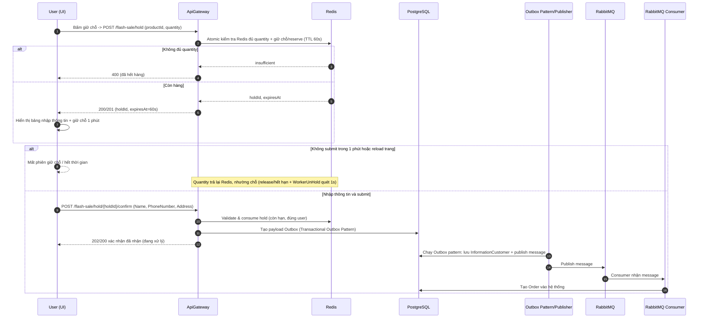

# Plan: Luồng Giữ chỗ (Hold) trước khi mua - FlashSale

> **Trạng thái:** Đã chốt quyết định Story 8.1 (2026-11-18). Chi tiết contract/DB-message/transaction cụ thể hóa ở Story 8.2. Chưa implement.  
> **Ngày tạo/cập nhật:** 2026-11-18  
> **Phạm vi:** Thay đổi luồng mua hàng (FR-02/FR-03, UI mua hàng) theo flow chuẩn đã chốt.

## 1. Mục tiêu (flow chuẩn)

- Khi người dùng bấm **"Giữ chỗ/Mua ngay"**: hệ thống **kiểm tra trong Redis xem còn đủ quantity không**.
  - Nếu **không đủ**: trả về lỗi **đã hết hàng**.
  - Nếu **còn hàng**: hiển thị **bảng nhập thông tin** và **giữ chỗ trong 1 phút** (reserve quantity trên Redis).
- Nếu trong vòng **1 phút** không submit bảng nhập thông tin, hoặc **reload lại trang**: **trả lại quantity trong Redis** và nhường chỗ cho người khác (hủy/release hoặc hết hạn được `FlashSale.WorkerUnHold` nhả slot).
- Nếu người dùng **nhập thông tin và submit**: hệ thống **tạo payload trong Outbox pattern**. Outbox pattern chạy và **lưu thông tin `InformationCustomer`** + **publish message**. Sau đó **RabbitMQ consumer** nhận message và **tạo Order** vào hệ thống.

## 2. Hiện trạng (đang triển khai)

- **API:** `POST /api/v1/flash-sale/buy` (`FlashSaleController`)
  1. Validate `productId`, `quantity`, `clientId` (Bearer token).
  2. Gọi `IInventoryService.DeductInventoryAsync` → trừ tồn kho Redis atomic ngay (`inventory:{productId}`).
  3. Tạo `orderId`, publish `OrderCreatedMessage` vào RabbitMQ (`order_pipeline_queue`).
  4. Trả `202 Accepted` (`ORDER_ACCEPTED`, "Đơn hàng đã được nhận và đang được xử lý.").
- **Redis:** `atomic_inventory_deduct.lua` trừ trực tiếp `GET/SET inventory:{productId}`.
- **Worker:** `OrderCreatedConsumerService` consume message, tạo `Order` + `Outbox` trong 1 transaction PostgreSQL (idempotent theo `orderId`).
- **Frontend (`/buy`):** form `productId`, `quantity` → submit gọi `/api/v1/flash-sale/buy` → hiển thị kết quả 202/400/401/429/5xx.

## 3. Luồng chuẩn (tổng quan)

## 4. Thiết kế Backend (đề xuất)

### 4.1 API endpoints

| Endpoint | Mục đích | Request (đề xuất) | Response thành công | Response lỗi chính | Ghi chú |
|---|---|---|---|---|---|
| `POST /api/v1/flash-sale/hold` | Bấm "Mua ngay": kiểm tra tồn kho trên Redis, nếu còn thì giữ chỗ | `{ productId, quantity }` | `200/201 { holdId, productId, quantity, expiresAt, ttlSeconds: 60 }` | `400 { code: "INSUFFICIENT_INVENTORY", message: "Sản phẩm đã hết hàng..." }` khi Redis không còn đủ sản phẩm; `429` khi vượt RateLimit | Atomic: kiểm tra tồn kho + tạo hold/reserve + TTL 60s |
| `POST /api/v1/flash-sale/hold/{holdId}/confirm` | Submit bảng nhập thông tin, xác nhận mua | `{ holdId?, productId?, quantity?, fullName, phone, address }` *(đề xuất field theo quyết định 8.1)* | `202 Accepted { orderId, holdId, ... }` | `409/410` khi hold hết hạn/không hợp lệ/đã dùng | Chỉ hợp lệ khi hold còn hạn, đúng user, chưa consume; thông tin khách hàng lưu ở DB theo quyết định |
| `POST /api/v1/flash-sale/hold/{holdId}/release` | User chủ động hủy giữ chỗ | - | `200` | `404/409/410` | Nhả slot sớm (đã chốt: có nút Hủy giữ chỗ) |
| `GET /api/v1/flash-sale/hold/{holdId}` *(không triển khai ở giai đoạn này)* | Lấy trạng thái/còn bao lâu | - | `{ status, expiresAt, remainingSeconds }` | `404/410` | Không cần resume sau reload (đã chốt: reload trang mất hold) |

**Tương thích ngược (đã chốt 2026-11-18):** `POST /api/v1/flash-sale/buy` **chạy song song** với luồng hold/confirm mới (giữ endpoint hiện tại, thêm endpoint hold/confirm). Thời điểm deprecated/loại bỏ `/buy` (nếu có) sẽ xem xét sau.

### 4.2 Bảng nhập thông tin (confirm payload)

**Đã chốt (2026-11-18):**
- Bảng nhập thông tin gồm: **Họ tên** (`fullName` -> `Name`), **Phone** (`phone` -> `PhoneNumber`), **Địa chỉ** (`address` -> `Address`).
- **Validation:** bắt buộc nhập đầy đủ cả 3 trường (không được để trống).
- **Lưu trữ DB:** khi khách hàng nhập thông tin và submit confirm, hệ thống **phải lưu được thông tin khách hàng vào Database** trong **bảng mới `InformationCustomer`** với các cột:
  - `Id`
  - `Name`
  - `Address`
  - `PhoneNumber`
  - `HoldId`
- Hệ thống tự gắn: `clientId` (từ JWT), `holdId`, `productId`, `quantity`.

**[CẦN LÀM RŐ]** Quy tắc validation chi tiết bổ sung (độ dài tối đa, định dạng số điện thoại, trim/ký tự hợp lệ), kiểu dữ liệu/ràng buộc/khóa chính-khóa ngoại của `InformationCustomer` (ví dụ liên kết `HoldId`/`OrderId`/`ClientId`, uniqueness), và có cần đưa thông tin `InformationCustomer` + `holdId` vào message/payload `OrderCreatedMessage`/`Outbox` hay chỉ lưu DB.

### 4.3 Redis - mô hình giữ chỗ và tính sẵn sàng

Mục tiêu kỹ thuật: ngăn oversell/over-hold, nhường slot khi hết hạn, thao tác atomic.

**Đề xuất mô hình (khuyến nghị): Reserve-on-hold**

- Khi **bấm "Mua ngay" / tạo hold**: thực hiện atomic trên Redis
  - Kiểm tra ràng buộc **1 user chỉ giữ 1 hold cùng lúc** (theo quyết định 8.1); nếu user đang có hold active thì từ chối tạo hold mới (mã lỗi cụ thể sẽ chốt khi thiết kế API).
  - **Kiểm tra tồn kho còn hay không** (`inventory:{productId}` hoặc available tương đương) cho `quantity` yêu cầu.
  - Nếu **hết sản phẩm/không đủ số lượng**: trả về lỗi hết sản phẩm (`INSUFFICIENT_INVENTORY`), **không** tạo hold.
  - Nếu **còn sản phẩm**: **giảm tồn kho khả dụng** ngay để giữ slot, chặn request khác giữ/chốt cùng slot.
  - Tạo key hold: `hold:{holdId}` (hash/string/json) chứa `productId, quantity, clientId, status=active, expiresAt` với **TTL = 60s**.
  - Lưu index theo user (ví dụ `hold:user:{clientId}` -> `holdId`) để enforce "1 user / 1 hold active".
- Khi **confirm** (trong TTL): atomic
  - Kiểm tra hold tồn tại, `status=active`, đúng `clientId`, chưa hết hạn.
  - Validate thông tin khách hàng bắt buộc (Họ tên, Phone, Địa chỉ).
  - Đánh dấu consumed/xóa hold (chống double-confirm) và xóa index user tương ứng.
  - **Không trừ thêm tồn kho** (đã reserve khi hold); lưu thông tin vào bảng `InformationCustomer` và publish message tạo Order theo luồng đã chốt.
- Khi **hết hạn/hủy/release**: atomic hoàn trả
  - Nếu hold còn `active` tại thời điểm xử lý hết hạn/hủy: **cộng trả lại `quantity`** vào tồn kho khả dụng, xóa/đánh dấu hold `expired|released`, và xóa index user tương ứng.

> **Đã chốt (2026-11-18):** mô hình kỹ thuật là **reserve ngay khi hold** (giảm available trên Redis để giữ slot) và **trả lại khi hết hạn/hủy**; **confirm chỉ chốt hold** (không trừ thêm tồn kho). Diễn giải nghiệp vụ: "Mua ngay" = giữ chỗ/slot; "submit thông tin" = chốt đơn.

**Các key đề xuất (tên kỹ thuật, cần chuẩn hóa khi implement):**
- `inventory:{productId}`: số lượng khả dụng hiện tại (giữ vai trò như hiện tại, nhưng ngữ nghĩa là available-to-hold/available).
- `hold:{holdId}`: dữ liệu hold + TTL 60s.
- `hold:user:{clientId}` (hoặc tương đương): index enforce 1 user chỉ có 1 hold active.
- `holds:expiring` / sorted set theo `expiresAt`: phục vụ job quét hết hạn chủ động và nhả slot (đề xuất, chờ chốt SLA ở câu 7).

**Atomicity:** dùng Lua script riêng cho `create_hold`, `confirm_hold`, `release_hold` (tương tự pattern `atomic_inventory_deduct.lua`, `rate_limit_token_bucket.lua`).

### 4.4 Hết hạn 1 phút và nhường chỗ

Redis TTL tự xóa key `hold:{holdId}` nhưng **không tự cộng trả inventory**. Cần cơ chế đảm bảo trả slot:

- **Cơ chế chính (đã chốt 2026-11-18):** tạo worker riêng **`FlashSale.WorkerUnHold`** chạy background job **quét mỗi 1 giây**, dựa trên sorted set/index `expiresAt` (ví dụ `holds:expiring`) và gọi thao tác atomic `release_if_expired` để trả inventory + dọn `hold:{holdId}`/`hold:user:{clientId}`/member trong set. Idempotent.
- **Cơ chế bổ trợ:** khi `confirm`/`release` gặp hold không tồn tại hoặc đã hết hạn → trả lỗi phù hợp (ví dụ `410 Gone`/`409 Conflict`, thông điệp "Giữ chỗ đã hết hạn (quá 1 phút). Vui lòng giữ chỗ lại."); nếu phát hiện trạng thái chưa được hoàn trả (edge case) thì trigger hoàn trả idempotent.
- **Keyspace notifications:** không dùng làm nguồn tin cậy duy nhất (có thể mất event), chỉ cân nhắc bổ sung.
- **Reload trang:** frontend không khôi phục hold (đã chốt), nhưng hold phía server vẫn tồn tại và giữ slot cho đến khi hết hạn/được nhả theo cơ chế trên.
- **SLA nhả slot:** quét mỗi **1 giây** (độ trễ nhả slot sau hết hạn mục tiêu ~1–2s).
- **Anti-abuse (đã chốt hiện tại):** 1 user chỉ giữ 1 hold active (enforce Redis) + áp dụng RateLimit hiện có cho `POST /flash-sale/hold` và confirm; chưa thêm giới hạn bổ sung.

### 4.5 Luồng submit confirm -> Outbox -> RabbitMQ -> Order (flow chuẩn)

- Khi người dùng **nhập thông tin và submit** (còn trong thời gian giữ chỗ):
  1. API validate hold (còn hạn, đúng user, chưa consumed) và validate thông tin bắt buộc (**Name/Họ tên, PhoneNumber/Phone, Address/Địa chỉ**).
  2. API consume/chốt hold (reserve đã giữ từ bước hold, không trừ thêm tồn kho) và **tạo payload trong Outbox pattern** (ghi bản ghi Outbox trong DB theo Transactional Outbox Pattern, payload chứa dữ liệu cần thiết như `holdId`, `orderId`/correlation, `productId`, `quantity`, `clientId`, thông tin khách hàng).
  3. **Outbox pattern chạy** (Outbox publisher/processor): **lưu thông tin `InformationCustomer`** vào DB (`Id`, `Name`, `Address`, `PhoneNumber`, `HoldId`) và **publish 1 message** lên RabbitMQ.
  4. **RabbitMQ consumer** nhận message và **tạo Order** vào hệ thống (idempotent).
- **Không submit trong 1 phút hoặc reload trang:** không thực hiện bước submit; quantity được trả lại Redis và nhường chỗ (qua release/hủy nếu gọi được, hoặc hết hạn và `FlashSale.WorkerUnHold` quét nhả mỗi 1s).
- **Lưu ý thiết kế:** cần đảm bảo tính nhất quán khi lưu `InformationCustomer`, Outbox và publish/tạo Order (thứ tự/thao tác cụ thể trong transaction hoặc trong bước xử lý Outbox sẽ được chốt chi tiết ở 8.2, nhưng phải đảm bảo submit thành công thì thông tin khách hàng được lưu vào DB).

### 4.6 Ảnh hưởng mã nguồn (dự kiến)

- `src/FlashSale.Api/Controllers/FlashSaleController.cs`: thêm endpoint hold/confirm/release (hoặc controller/service mới); giữ `POST /api/v1/flash-sale/buy` chạy song song.
- `src/FlashSale.Application/*`: commands/validators/handlers/interfaces cho hold/confirm/release; tạo payload/ghi Outbox khi submit confirm theo flow chuẩn.
- `src/FlashSale.Infrastructure/ExternalServices/Redis/*`: repository/service + Lua scripts (`hold_create.lua`, `hold_confirm.lua`, `hold_release.lua`), key/index conventions (`hold:{id}`, `hold:user:{clientId}`, `holds:expiring`).
- `src/FlashSale.Infrastructure/Persistence/*` và `src/FlashSale.Domain/*`: entity/repository/DbContext/migration cho bảng `InformationCustomer` (`Id`, `Name`, `Address`, `PhoneNumber`, `HoldId`) và Outbox/payload cần thiết; entity/exception/contract cho Hold nếu cần.
- `src/FlashSale.Application/*` hoặc `src/FlashSale.Worker/*` (Outbox publisher/processor hiện có): xử lý Outbox pending để **lưu `InformationCustomer` và publish message** lên RabbitMQ theo flow chuẩn.
- `src/FlashSale.Worker/*` (consumer hiện có/điều chỉnh): consumer RabbitMQ nhận message và **tạo Order** vào hệ thống (idempotent).
- `src/FlashSale.WorkerUnHold/*` (mới): worker riêng quét/nhả hold hết hạn mỗi 1 giây.
- `docker-compose.yml`, solution/tests: bổ sung service/project/test cho `FlashSale.WorkerUnHold` và luồng mới.
- Tests: unit/integration cho atomic hold/confirm/expire/release, Outbox publish/lưu `InformationCustomer`, consumer tạo Order, API contract, worker expiry release, e2e luồng mới.

## 5. Thiết kế Frontend (Angular, `/buy`)

### 5.1 Trạng thái UI đề xuất

| Trạng thái | Mô tả | Hành động |
|---|---|---|
| Idle | Nhập `productId`, `quantity` | Bấm **"Mua ngay"** |
| Holding (loading) | Đang gọi API kiểm tra tồn kho Redis và giữ chỗ | Disable nút |
| Held | Redis còn sản phẩm, giữ chỗ thành công, còn `ttl` | Hiển thị **bảng nhập thông tin** (Họ tên, Phone, Địa chỉ - bắt buộc) + countdown 1 phút + nút **"Xác nhận/Đặt hàng"** + nút **"Hủy giữ chỗ"** |
| OutOfStock | Redis hết sản phẩm/không đủ số lượng khi bấm "Mua ngay" | Hiển thị thông báo **"Sản phẩm đã hết hàng."** (hoặc tương đương), không hiển thị bảng nhập thông tin, cho phép thử lại sau |
| Confirming | Đang submit thông tin | Disable form |
| Success | Confirm thành công, nhận 202/orderId | Thông báo thành công (theo tone hiện tại) |
| Expired | Hết 1 phút chưa submit hoặc confirm bị từ chối do hết hạn | Ẩn/khóa form thông tin, thông báo hết hạn, yêu cầu bấm **"Mua ngay"** để giữ chỗ lại |
| Cancelled | User bấm "Hủy giữ chỗ" | Gọi API release, quay về trạng thái sẵn sàng/Idle |
| Error | 401/409/410/429/5xx (lỗi khác) | Hiển thị lỗi rõ ràng, cho phép thử lại phù hợp |

### 5.2 Hành vi cần có

- Khi bấm **"Mua ngay/Giữ chỗ"**: gọi API hold; backend kiểm tra Redis đủ quantity — nếu **hết hàng** thì hiển thị lỗi hết hàng, không chuyển sang bước nhập thông tin; nếu **còn hàng** thì giữ chỗ thành công (1 phút).
- Sau khi hold thành công: lưu `holdId`, `expiresAt`, chuyển UI sang bước nhập thông tin.
- Bảng nhập thông tin gồm **Họ tên (Name), Phone (PhoneNumber), Địa chỉ (Address)** và **bắt buộc nhập đầy đủ** trước khi submit.
- **Countdown 60s** trên UI; khi về 0: tự chuyển trạng thái Expired, vô hiệu hóa submit, hiển thị thông báo nhường chỗ.
- Có nút **"Hủy giữ chỗ"**: gọi API release để nhả slot sớm, quay về trạng thái sẵn sàng.
- **Không submit trong 1 phút hoặc reload trang:** không thể tiếp tục giữ chỗ này; quantity được trả lại Redis và nhường chỗ (khi hết hạn/release; sau reload do mất `holdId` phía client, việc nhả slot thực hiện theo cơ chế hết hạn `WorkerUnHold` quét 1s).
- Submit bảng nhập thông tin: gọi confirm với `holdId` + dữ liệu form; **kiểm tra hết hạn tại thời điểm submit là đủ**. Nếu hết hạn/không hợp lệ/đã dùng → báo lỗi/hết hạn.
- Sau submit thành công: hệ thống tạo payload Outbox, Outbox pattern chạy để lưu `InformationCustomer` và publish message, RabbitMQ consumer tạo Order (UI hiển thị trạng thái đã nhận/đang xử lý theo response API).
- Xử lý 401 (logout/redirect login), 429 (RateLimit), hết hàng (`INSUFFICIENT_INVENTORY`), user đã có hold active (mã lỗi theo thiết kế).
- **[CẦN LÀM RÕ]** Quy tắc validation chi tiết (định dạng/độ dài) và có cho sửa `quantity/product` sau khi giữ chỗ không (khuyến nghị: không).

### 5.3 File/khối frontend dự kiến thay đổi

- `frontend/flash-sale-web/src/app/features/flash-sale/buy/buy.component.*` (state machine/UI 2 bước + countdown + form thông tin)
- `frontend/flash-sale-web/src/app/features/flash-sale/buy/flash-sale.service.ts` (thêm `hold`, `confirmHold`, `releaseHold/getHold`)
- `frontend/flash-sale-web/src/app/features/flash-sale/buy/buy.models.ts`
- Tests: unit/integration (`buy.component.spec.ts`, `buy.api.integration.spec.ts`) theo luồng mới.
- Cập nhật UX spec: `docs/ux-flashsale-buy-screen.md` (và `docs/ux.md` nếu cần).

## 6. Ảnh hưởng tài liệu & nghiệp vụ

- `docs/prd.md`, `docs/architecture.md`: cập nhật luồng fast-path/FR-02, FR-03 (tách hold và confirm), mô tả Redis keys/job hết hạn.
- `docs/domain-glossary.md`: bổ sung thuật ngữ nếu chốt (ví dụ `Hold`/`Reservation`, `HoldExpiry`, endpoint/contract names) theo quy ước.
- `docs/decisions.md`: ghi quyết định mô hình reserve-on-hold, cơ chế nhả slot khi hết hạn, payload confirm, tương thích `/buy`.
- `docs/status.md`: thêm/cập nhật story cho phase triển khai (BE/FE/tests/docs).

## 7. Rủi ro & edge cases

- **Không nhả được slot khi hết hạn:** inventory bị "kẹt" nếu chỉ dựa TTL key. Cần cơ chế release idempotent + job quét.
- **Race condition:** double confirm, confirm sau hết hạn, hold và confirm đồng thời với release — bắt buộc xử lý bằng Lua/script atomic.
- **User đóng tab/reload trang:** reload trang làm mất phiên giữ chỗ trên UI (không submit/hủy tiếp được). Theo flow chuẩn, quantity phải được trả lại/nhường chỗ; thực tế slot được nhả khi hết hạn/release và `FlashSale.WorkerUnHold` quét (SLA ~1–2s sau hết hạn) nếu không có release tường minh.
- **Đồng hồ client lệch:** dùng `expiresAt` từ server và/hoặc `remainingSeconds`; quyết định hết hạn/confirm tại server.
- **RateLimit/abuse:** đã chốt 1 user chỉ giữ 1 hold active cùng lúc và áp dụng RateLimit hiện có cho endpoint hold/confirm; hiện chưa thêm giới hạn bổ sung (có thể điều chỉnh sau khi quan sát).
- **Thay đổi semantics inventory metric/monitoring:** `InventoryRemaining` được hiểu là **số lượng tồn kho khả dụng để giữ/chốt** (available sau khi reserve hold); khi hold hết hạn/hủy và trả slot thì giá trị tăng tương ứng. Dashboard/label/Prometheus mô tả cần được cập nhật ở 8.2/8.8 nếu cần làm rõ nghĩa (chưa thêm metric hold riêng trong phạm vi chốt hiện tại).

## 8. Câu hỏi cần Đại ca chốt

1. ~~"Bảng nhập thông tin" gồm những field nào, validation, lưu ở đâu?~~ **Đã chốt (2026-11-18):** gồm **Họ tên, Phone, Địa chỉ**; **bắt buộc nhập đầy đủ**; khi submit confirm phải **lưu được thông tin khách hàng vào DB** trong bảng mới **`InformationCustomer`** (`Id`, `Name`, `Address`, `PhoneNumber`, `HoldId`). **Còn mở (chi tiết thiết kế):** validation chi tiết (độ dài/định dạng SĐT), kiểu dữ liệu/ràng buộc/khóa liên kết/migration, và có đưa vào message/payload không (cụ thể hóa ở 8.2).
2. ~~Xác nhận mô hình kỹ thuật reserve/confirm/release?~~ **Đã chốt (2026-11-18):** **reserve ngay khi hold** (giảm available trên Redis để giữ slot), **trả lại khi hết hạn/hủy**, **confirm chỉ chốt hold** (không trừ thêm tồn kho).
3. ~~Quy tắc số hold mỗi user?~~ **Đã chốt (2026-11-18):** **1 user chỉ giữ 1 hold cùng lúc**.
4. ~~Xử lý endpoint cũ `POST /api/v1/flash-sale/buy`?~~ **Đã chốt (2026-11-18):** **chạy song song** với hold/confirm.
5. ~~Cách xử lý hết hạn trên UI?~~ **Đã chốt (2026-11-18):** **kiểm tra khi submit là đủ** (server chặn confirm + nhả slot, UI countdown).
6. ~~Hủy giữ chỗ / resume sau reload?~~ **Đã chốt (2026-11-18):** **có nút Hủy giữ chỗ**; **reload trang thì mất hold** (không resume).
7. ~~SLA nhả slot sau hết hạn và anti-abuse giữ chỗ?~~ **Đã chốt (2026-11-18):** tạo worker riêng **`FlashSale.WorkerUnHold`**, quét **mỗi 1 giây** bằng `holds:expiring` + Lua `release_if_expired` (idempotent); anti-abuse: 1 hold/user + RateLimit hiện có cho hold/confirm, chưa thêm giới hạn bổ sung.
8. ~~Semantics metrics/monitoring (`InventoryRemaining`, hold nếu có)?~~ **Đã chốt (2026-11-18):** `InventoryRemaining` phản ánh **tồn kho khả dụng để giữ/chốt** (available sau reserve). Chưa thêm metric hold riêng; cập nhật mô tả dashboard/metrics ở 8.2/8.8 nếu cần.

## 9. Đề xuất chia phase triển khai (sau khi chốt plan)

- **Phase A - Thiết kế chi tiết & contract:** chốt field/info, API schema, Redis key/Lua script, trạng thái hold, cập nhật docs (glossary/architecture/decisions/ux).
- **Phase B - Backend core:** implement hold/confirm/release + Lua atomic + endpoint + unit/integration tests.
- **Phase C - Expiry & reliability:** job nhả hold hết hạn, idempotency, chống abuse/race cases + tests.
- **Phase D - Frontend:** UI 2 bước (hold -> form thông tin + countdown -> confirm), xử lý expired/401/429/400, integration tests UI.
- **Phase E - Tương thích & rollout:** xử lý `/buy` cũ, migration/config, cập nhật dashboard/metrics nếu cần, verify e2e/k6 kịch bản mới.

---
*Ghi chú (Story 8.1): Các quyết định chính đã được chốt và ghi trong `docs/decisions.md`. Chi tiết thiết kế còn lại (validation định dạng/độ dài, kiểu dữ liệu/ràng buộc/khóa liên kết/migration cho `InformationCustomer`, cách lưu/publish qua Outbox và consumer tạo Order, transaction/consistency/idempotency, contract API/error code chi tiết, message/payload) được cụ thể hóa ở **Story 8.2**. Chưa thay đổi behavior/code hiện tại.*
